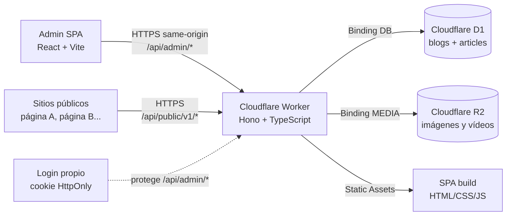
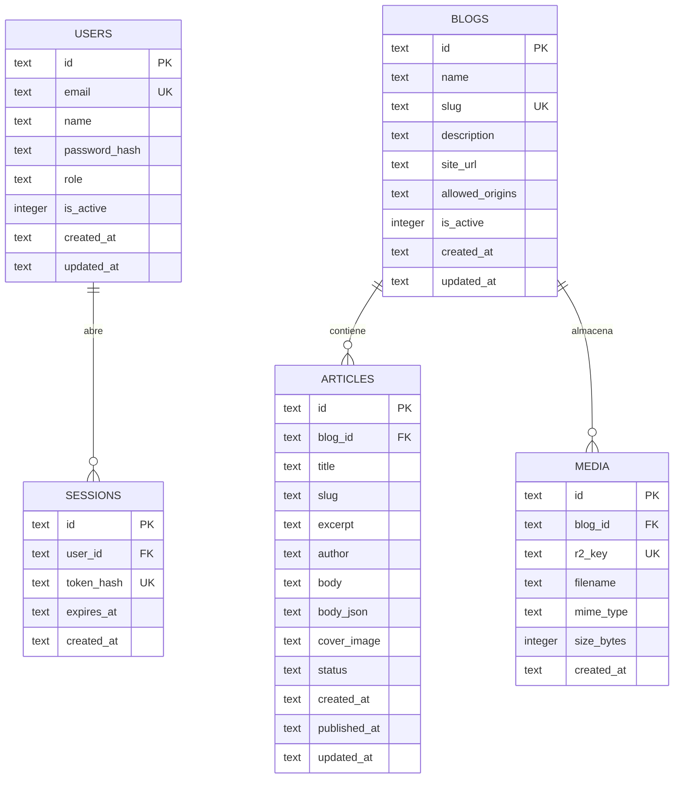

# Arquitectura — Blog Manager

> **Estado:** diseño actualizado con las decisiones confirmadas. Todavía no existe código de aplicación.
> **Fecha:** 2026-11-18
> **Objetivo:** gestor administrativo multi-blog, con artículos aislados por blog, API REST serverless en Cloudflare y una interfaz oscura, moderna y sobria.

---

## 1. Resumen ejecutivo

Blog Manager será una aplicación desplegada como **un único Worker de Cloudflare** que sirve, desde el mismo origen:

1. La **SPA de administración** (React + Vite).
2. La **API privada de administración** (`/api/admin/*`).
3. Una **API pública de solo lectura**, versionada y aislada por blog (`/api/public/v1/*`).
4. La **entrega de imágenes y vídeos** subidos a R2 (`/media/*`).

La base de datos será **Cloudflare D1** (SQLite gestionado). Aunque DynamoDB es NoSQL, D1 es el servicio de Cloudflare que mejor encaja con este dominio: permite relaciones blog → artículos, índices, restricciones de unicidad, filtros por estado/fecha y transacciones. KV sería la opción “key-value” literal, pero no ofrece consultas ni integridad referencial y sería mucho más frágil para este caso.



**Ventaja del Worker único:** un solo despliegue, sin CORS para la administración, secretos y bindings en un único lugar, y la SPA se sirve como static assets (sin invocar el Worker para cada navegación). En el MVP se despliega en el subdominio gratuito `*.workers.dev`, con un único host.

---

## 2. Decisiones de arquitectura

| Área | Decisión | Motivo |
|---|---|---|
| Runtime | **Cloudflare Workers** | Serverless, despliegue atómico, integración nativa con D1/R2, sin servidores que mantener. |
| Frontend | **React + Vite + TypeScript** | Requisito del proyecto; Vite da HMR y build rápido. |
| Backend | **Hono + TypeScript** sobre Workers | Router ligero, middleware, validación con Zod, tipado, excelente soporte en Workers. |
| Base de datos | **Cloudflare D1** | Relacional, consistente, índices, `UNIQUE`, `FOREIGN KEY`, transacciones y Time Travel. Es el servicio gestionado de Cloudflare más adecuado para este modelo. |
| Acceso a datos | **Drizzle ORM + SQL** | Esquema tipado, consultas seguras con parámetros y migraciones SQL generadas. |
| Autenticación | **Login propio multiusuario** | Requisito confirmado. Sin dependencia de dominio propio ni Zero Trust. |
| Usuarios | **Multiusuario con auto-registro, aprobación y permisos por blog** | Cada cuenta nueva queda pendiente hasta que un administrador le asigna consulta o edición sobre al menos un blog. |
| Imágenes y vídeos | **R2 + `/media/*` desde el MVP** | Copiar/pegar imágenes o vídeos y subirlos directamente desde el editor. |
| Borrado de blogs | **Bloqueado si tiene artículos** | Evita pérdidas accidentales; la FK `RESTRICT` refuerza la regla. |
| API pública | **Consumo desde navegador con CORS por blog** | Los sitios consultan desde el cliente; se permite el origen de `site_url` y orígenes extra. |
| Despliegue | **Un Worker en `*.workers.dev` + GitHub Actions/Workers Builds** | Host gratuito de Cloudflare para el MVP; un solo artefacto. |
| IaC | **`wrangler.jsonc` + script de bootstrap; sin Terraform en el MVP** | La configuración declarativa de Wrangler cubre el caso; Terraform añade coste de mantenimiento innecesario ahora. |
| Gestor de paquetes | **npm** | `pnpm` no está operativo en el entorno actual; npm funciona y es suficiente para un único paquete desplegable. |
| Idioma de UI | **Español** | Los estados y textos de negocio se muestran en español; el código y la API usan inglés. |

### 2.1. Aclaración sobre “Node.js”

Cloudflare Workers **no ejecuta Node.js completo**: ejecuta `workerd`, un runtime basado en estándares web. Activaremos la bandera `nodejs_compat` para dependencias que usen APIs de Node, pero el backend será TypeScript “estilo Node” ejecutándose en Workers.

Si en el futuro se necesitara un proceso Node real (por ejemplo, una librería nativa incompatible), la alternativa sería **Cloudflare Containers**, que no es adecuada para este caso: añade contenedores, cold starts y coste innecesario. Para una API REST de blogs, Workers es la opción correcta.

### 2.2. Por qué D1 y no KV

| Necesidad | D1 | KV |
|---|---|---|
| Artículos de un blog filtrados por estado y fecha | `WHERE blog_id = ? AND status IN (...)` con índice | Listar por prefijo y filtrar en memoria |
| Slug único por blog | `UNIQUE (blog_id, slug)` | Sin restricciones de unicidad |
| Borrado de blog con artículos | Bloqueado con `FOREIGN KEY ... ON DELETE RESTRICT` | Borrado manual y posible inconsistencia |
| Búsqueda administrativa | `LIKE` / FTS5 | No soportada de forma nativa |
| Consistencia | Fuerte en el primario | Eventual |
| Paginación estable | `ORDER BY` + cursor | Muy limitada |

D1 tiene límites de 500 MB por base en el plan gratuito y 10 GB en el plan pago, muy por encima de lo que necesita un gestor de blogs personales. Time Travel permite recuperación point-in-time (7 días en gratuito, 30 en pago).

---

## 3. Stack técnico

### Backend

| Pieza | Elección |
|---|---|
| Framework HTTP | `hono` |
| Validación | `zod` + `@hono/zod-validator` |
| ORM | `drizzle-orm` (driver `d1`) |
| Migraciones | `drizzle-kit generate` + `wrangler d1 migrations apply` |
| Autenticación | Sesiones opacas en D1 + HMAC-SHA256 con pepper |
| Medios | R2 binding + endpoint `/media/*` |
| Logs | `observability` de Workers + logs JSON estructurados |
| Tests | `vitest` + `@cloudflare/vitest-plugin` |

### Frontend

| Pieza | Elección |
|---|---|
| Framework | React + TypeScript |
| Build | Vite + `@cloudflare/vite-plugin` |
| Estilos | Tailwind CSS (v4) + tokens CSS |
| Componentes | shadcn/ui sobre Radix |
| Iconos | `lucide-react` |
| Router | React Router |
| Data fetching | TanStack Query |
| Formularios | React Hook Form + Zod |
| Editor rich text | Tiptap (ProseMirror) con extensiones propias |
| Fechas | `date-fns` con locale `es` |
| Toasts | Sonner |

> El editor se carga de forma diferida (`lazy`) porque es la dependencia más pesada del frontend.

---

## 4. Estructura del proyecto

Un único paquete npm, con tres zonas claramente separadas: cliente, servidor y contratos compartidos.

```text
blog-manager/
├─ src/
│  ├─ client/
│  │  ├─ main.tsx
│  │  ├─ app.tsx
│  │  ├─ router.tsx
│  │  ├─ components/
│  │  │  ├─ ui/                 # primitivas shadcn
│  │  │  ├─ layout/             # sidebar, header, shell
│  │  │  ├─ blogs/
│  │  │  ├─ articles/
│  │  │  └─ editor/
│  │  ├─ pages/
│  │  │  ├─ dashboard.tsx
│  │  │  ├─ blogs.tsx
│  │  │  ├─ blog-articles.tsx
│  │  │  ├─ article-editor.tsx
│  │  │  └─ login.tsx
│  │  ├─ hooks/
│  │  ├─ lib/                   # api client, query keys, utils
│  │  └─ styles.css
│  ├─ server/
│  │  ├─ index.ts               # Hono app + export del Worker
│  │  ├─ routes/
│  │  │  ├─ auth.ts
│  │  │  ├─ admin.ts            # blogs, artículos, media, stats y usuarios
│  │  │  ├─ public.ts
│  │  │  └─ media.ts
│  │  ├─ middleware/            # auth, request-id, errors, cors
│  │  ├─ db/
│  │  │  ├─ schema.ts
│  │  │  ├─ client.ts
│  │  │  └─ repositories/
│  │  ├─ services/              # slugs, fechas, visibilidad, auth, media
│  │  └─ lib/                   # http errors, logging
│  └─ shared/
│     ├─ schemas/               # Zod: blogs, articles, usuarios, filtros
│     └─ types.ts               # tipos inferidos y DTOs
├─ scripts/
│  ├─ bootstrap.ts             # crea D1/R2 y deja los IDs listos
│  └─ create-admin.ts          # crea el primer administrador
├─ migrations/
│  └─ 0000_initial.sql
├─ seeds/
│  └─ seed.sql
├─ tests/
│  ├─ api/
│  └─ unit/
├─ docs/
│  ├─ ARQUITECTURA.md
│  └─ PLAN_IMPLEMENTACION.md
├─ index.html
├─ vite.config.ts
├─ wrangler.jsonc
├─ drizzle.config.ts
├─ tsconfig.json
└─ package.json
```

**Regla de dependencias:** `client` y `server` pueden importar de `shared`; `shared` no importa de ninguno de los dos. El cliente nunca importa código de `server` (solo tipos, si hiciera falta).

---

## 5. Modelo de datos

### 5.1. Diagrama entidad-relación



### 5.2. Esquema SQL inicial

```sql
CREATE TABLE users (
  id            TEXT PRIMARY KEY,
  email         TEXT NOT NULL UNIQUE,
  name          TEXT NOT NULL,
  password_hash TEXT NOT NULL,
  role          TEXT NOT NULL DEFAULT 'admin'
                CHECK (role IN ('admin', 'editor')),
  is_active     INTEGER NOT NULL DEFAULT 1 CHECK (is_active IN (0, 1)),
  is_approved   INTEGER NOT NULL DEFAULT 0 CHECK (is_approved IN (0, 1)),
  created_at    TEXT NOT NULL,
  updated_at    TEXT NOT NULL
);

CREATE TABLE sessions (
  id         TEXT PRIMARY KEY,
  user_id    TEXT NOT NULL,
  token_hash TEXT NOT NULL UNIQUE,
  expires_at TEXT NOT NULL,
  created_at TEXT NOT NULL,
  FOREIGN KEY (user_id) REFERENCES users (id) ON DELETE CASCADE
);

CREATE INDEX idx_sessions_user ON sessions (user_id);
CREATE INDEX idx_sessions_expires ON sessions (expires_at);

-- Intentos de login por IP/email para rate limiting sin estado en memoria.
CREATE TABLE auth_attempts (
  attempt_key   TEXT PRIMARY KEY,
  attempts      INTEGER NOT NULL DEFAULT 0,
  window_start  INTEGER NOT NULL,
  blocked_until INTEGER
);

CREATE TABLE blogs (
  id              TEXT PRIMARY KEY,
  name            TEXT NOT NULL,
  slug            TEXT NOT NULL UNIQUE,
  description     TEXT NOT NULL DEFAULT '',
  site_url        TEXT NOT NULL,
  allowed_origins TEXT NOT NULL DEFAULT '',
  is_active       INTEGER NOT NULL DEFAULT 1 CHECK (is_active IN (0, 1)),
  created_at      TEXT NOT NULL,
  updated_at      TEXT NOT NULL
);

CREATE INDEX idx_blogs_active ON blogs (is_active);

-- Permisos por blog para editores. Los administradores no necesitan filas.
CREATE TABLE blog_permissions (
  user_id    TEXT NOT NULL,
  blog_id    TEXT NOT NULL,
  permission TEXT NOT NULL CHECK (permission IN ('read', 'write')),
  created_at TEXT NOT NULL,
  PRIMARY KEY (user_id, blog_id),
  FOREIGN KEY (user_id) REFERENCES users (id) ON DELETE CASCADE,
  FOREIGN KEY (blog_id) REFERENCES blogs (id) ON DELETE CASCADE
);

CREATE INDEX idx_blog_permissions_blog ON blog_permissions (blog_id);

CREATE TABLE articles (
  id           TEXT PRIMARY KEY,
  blog_id      TEXT NOT NULL,
  title        TEXT NOT NULL,
  slug         TEXT NOT NULL,
  excerpt      TEXT NOT NULL DEFAULT '',
  author       TEXT NOT NULL,
  body         TEXT NOT NULL DEFAULT '',
  body_json    TEXT,
  cover_image  TEXT,
  status       TEXT NOT NULL DEFAULT 'draft'
               CHECK (status IN ('draft', 'published', 'hidden', 'featured')),
  created_at   TEXT NOT NULL,
  published_at TEXT,
  updated_at   TEXT NOT NULL,
  FOREIGN KEY (blog_id) REFERENCES blogs (id) ON DELETE RESTRICT,
  UNIQUE (blog_id, slug)
);

CREATE INDEX idx_articles_blog_updated
  ON articles (blog_id, updated_at DESC);

CREATE INDEX idx_articles_blog_status_published
  ON articles (blog_id, status, published_at DESC);

CREATE INDEX idx_articles_blog_created
  ON articles (blog_id, created_at DESC);

CREATE TABLE media (
  id         TEXT PRIMARY KEY,
  blog_id    TEXT NOT NULL,
  r2_key     TEXT NOT NULL UNIQUE,
  filename   TEXT NOT NULL,
  mime_type  TEXT NOT NULL,
  size_bytes INTEGER NOT NULL,
  created_at TEXT NOT NULL,
  FOREIGN KEY (blog_id) REFERENCES blogs (id) ON DELETE CASCADE
);
```

> D1 aplica las claves foráneas por defecto. `articles` usa `ON DELETE RESTRICT`: un blog con artículos no se puede borrar, ni siquiera por error desde SQL. `media` y `blog_permissions` usan `ON DELETE CASCADE`; los objetos de R2 se eliminan en el servicio antes de borrar el blog (ver §10). El primer administrador se crea con `scripts/create-admin.ts`; no hay contraseñas por defecto.

### 5.3. Campos y reglas

#### Blog

| Campo | Tipo | Regla |
|---|---|---|
| `id` | UUID | Generado en el servidor con `crypto.randomUUID()`. |
| `name` | string | 1–120 caracteres, obligatorio. |
| `slug` | string | Único global; `[a-z0-9-]`, 1–80; se genera desde `name`, editable. |
| `description` | string | Hasta 500 caracteres. Puede estar vacío. |
| `site_url` | string | URL absoluta `http`/`https`, obligatoria. |
| `allowed_origins` | string | Lista separada por comas de orígenes CORS extra. El origen de `site_url` se permite siempre. La API lo expone como array `allowedOrigins`. |
| `is_active` | boolean | Activo/inactivo. Un blog inactivo devuelve 404 en la API pública. |
| `created_at` | ISO 8601 | UTC, generado por el servidor. |
| `updated_at` | ISO 8601 | UTC, actualizado por el servidor. |

#### Usuario

| Campo | Tipo | Regla |
|---|---|---|
| `id` | UUID | Generado en el servidor. |
| `email` | string | Único global, minúsculas, formato de email válido. |
| `name` | string | 1–120 caracteres. |
| `password_hash` | string | HMAC-SHA256 con pepper y salt por usuario (`hmac-sha256$1$salt$hash`). El pepper vive en un secret del Worker, no en D1. Nunca se devuelve en la API. |
| `role` | enum | `admin` o `editor`. Los administradores tienen acceso completo; los editores dependen de `blog_permissions`. |
| `is_active` | boolean | Un usuario desactivado no puede iniciar sesión. |
| `is_approved` | boolean | Empieza en `false` en el auto-registro. Un usuario no aprobado recibe `403` con «Usuario pendiente de aprobación». Los usuarios creados por CLI quedan aprobados. |
| `created_at` | ISO 8601 | UTC, generado por el servidor. |
| `updated_at` | ISO 8601 | UTC, actualizado por el servidor. |

#### Permiso por blog

| Campo | Tipo | Regla |
|---|---|---|
| `user_id` | UUID | Usuario editor; FK con `ON DELETE CASCADE`. |
| `blog_id` | UUID | Blog al que da acceso; FK con `ON DELETE CASCADE`. |
| `permission` | enum | `read` (consulta) o `write` (edición). |
| `created_at` | ISO 8601 | UTC. |

La clave primaria es `(user_id, blog_id)`: un usuario tiene como máximo un permiso por blog. Los administradores no usan esta tabla y siempre obtienen `write`. Un editor aprobado debe tener al menos un permiso; la API lo valida con `APPROVAL_REQUIRES_PERMISSION`.

#### Sesión

| Campo | Tipo | Regla |
|---|---|---|
| `id` | UUID | Identificador interno de la sesión. |
| `user_id` | UUID | Usuario propietario; FK con `ON DELETE CASCADE`. |
| `token_hash` | string | SHA-256 del token que viaja en la cookie. La BD nunca guarda el token en claro. |
| `expires_at` | ISO 8601 | Expiración absoluta (7 días por defecto). |
| `created_at` | ISO 8601 | UTC. |

#### Artículo

| Campo | Tipo | Regla |
|---|---|---|
| `id` | UUID | Generado en el servidor. |
| `blog_id` | UUID | Obligatorio; debe existir. Inmutable después de crear. |
| `title` | string | 1–200 caracteres, obligatorio. |
| `slug` | string | Único **por blog**; 1–200; se genera desde `title`, editable. |
| `excerpt` | string | Descripción corta, hasta 300 caracteres. |
| `author` | string | 1–120 caracteres, obligatorio. |
| `body` | HTML | HTML generado en el servidor a partir de `body_json`; es lo que sirve la API pública. |
| `body_json` | JSON (texto) | Documento Tiptap serializado, hasta 1 MB. Fuente de verdad editable. `NULL` en artículos anteriores a la migración `0002`. |
| `cover_image` | URL o `NULL` | Imagen de portada. Se muestra en listados y en la API pública; se sube con el mismo endpoint de medios y se limpia al reemplazarla o quitarla. |
| `status` | enum | `draft`, `published`, `hidden`, `featured`. |
| `created_at` | ISO 8601 | UTC, generado por el servidor. Inmutable. |
| `published_at` | ISO 8601 o `null` | Fecha de publicación editable. Si se publica sin fecha, el servidor pone `now`. |
| `updated_at` | ISO 8601 | UTC, actualizado por el servidor. |

**Borrado de blogs:** si el blog tiene al menos un artículo, `DELETE` responde `409 BLOG_HAS_ARTICLES` con `articleCount`. La FK `ON DELETE RESTRICT` impide el borrado a nivel de base. La UI ofrece desactivar el blog o eliminar primero los artículos.

**Decisión sobre `featured`:** se sigue el requisito literal de tratarlo como un estado. Un artículo `featured` es visible públicamente y puede filtrarse con `?status=featured` o `?featured=true`. La web consumidora decide si lo destaca visualmente. `draft` y `hidden` nunca se exponen en la API pública.

**Fechas:** todas se guardan en UTC ISO 8601 (`2026-11-18T10:30:00.000Z`). La UI las muestra en la zona horaria local con `date-fns` (`es`). La fecha de creación es automática; la de publicación es editable.

**Slugs:** se generan con `slugify` (minúsculas, sin acentos, guiones). Si el slug automático colisiona, se añade `-2`, `-3`, etc. Si el usuario escribe uno manual y colisiona, la API responde `409 CONFLICT` indicando el campo.

---

## 6. API REST

### 6.1. Convenciones

- Base privada: `/api/admin`
- Base pública: `/api/public/v1`
- Formato: JSON UTF-8.
- Fechas: ISO 8601 UTC.
- IDs: UUID.
- Autenticación de admin: cookie de sesión `HttpOnly` (login propio multiusuario).
- La API pública es de solo lectura, no usa cookies y permite CORS desde los orígenes configurados en cada blog.
- Respuestas de error uniformes:

```json
{
  "error": {
    "code": "NOT_FOUND",
    "message": "Blog no encontrado",
    "requestId": "01J..."
  }
}
```

- Listados paginados:

```json
{
  "data": [],
  "meta": {
    "page": 1,
    "pageSize": 20,
    "total": 42
  }
}
```

Códigos de error previstos: `VALIDATION_ERROR`, `UNAUTHORIZED`, `FORBIDDEN`, `NOT_FOUND`, `CONFLICT` (incluye `SLUG_DUPLICADO`, `BLOG_HAS_ARTICLES`, `EMAIL_IN_USE`), `RATE_LIMITED`, `INVALID_CREDENTIALS`, `USER_PENDING_APPROVAL`, `APPROVAL_REQUIRES_PERMISSION`, `CANNOT_DELETE_SELF`, `CANNOT_DEACTIVATE_SELF`, `CANNOT_DEMOTE_SELF`, `LAST_ADMIN`, `INTERNAL`.

### 6.2. Endpoints de administración

#### Auth

| Método | Ruta | Descripción |
|---|---|---|
| `POST` | `/api/auth/register` | Auto-registro público; crea un editor no aprobado. Rate limited por IP. |
| `POST` | `/api/auth/login` | Email + contraseña; crea cookie de sesión. Rate limited. Rechaza no aprobados con «Usuario pendiente de aprobación». |
| `POST` | `/api/auth/logout` | Cierra la sesión actual y borra la cookie. |
| `GET` | `/api/auth/me` | Devuelve el usuario actual o 401. |
| `PATCH` | `/api/auth/profile` | Cambia el nombre del usuario actual. |
| `PATCH` | `/api/auth/password` | Cambia la contraseña (exige la actual), conserva la sesión actual y revoca las demás. |

El primer administrador se crea con `scripts/create-admin.ts` y queda aprobado. A partir de ahí, el resto de cuentas pueden auto-registrarse o crearse desde `/users`.

#### Blogs

| Método | Ruta | Descripción |
|---|---|---|
| `GET` | `/api/admin/blogs` | Lista con `q`, `active`, `page`, `pageSize`, `sort`. Incluye `articleCount` y `permission`. Un editor solo ve sus blogs asignados. |
| `POST` | `/api/admin/blogs` | Crea blog. Solo `admin`. |
| `GET` | `/api/admin/blogs/:blogId` | Detalle. Requiere permiso `read`. |
| `PATCH` | `/api/admin/blogs/:blogId` | Actualiza campos parciales, incluidos `isActive` y `allowedOrigins`. Solo `admin`. |
| `DELETE` | `/api/admin/blogs/:blogId` | Elimina el blog solo si no tiene artículos; si los tiene, `409 BLOG_HAS_ARTICLES`. Solo `admin`. |

Ejemplo de bloqueo de borrado:

```json
{
  "error": {
    "code": "BLOG_HAS_ARTICLES",
    "message": "No se puede eliminar un blog con artículos. Desactívalo o elimina sus artículos primero.",
    "details": { "articleCount": 12 },
    "requestId": "01J..."
  }
}
```

#### Artículos (siempre anidados bajo un blog)

| Método | Ruta | Descripción |
|---|---|---|
| `GET` | `/api/admin/blogs/:blogId/articles` | Lista con `q`, `status`, `sort`, `page`, `pageSize`. Requiere `read`. |
| `POST` | `/api/admin/blogs/:blogId/articles` | Crea artículo en ese blog. Requiere `write`. |
| `GET` | `/api/admin/blogs/:blogId/articles/:articleId` | Detalle. Requiere `read`. |
| `PATCH` | `/api/admin/blogs/:blogId/articles/:articleId` | Actualiza campos parciales, incluido `status`. Requiere `write`. |
| `DELETE` | `/api/admin/blogs/:blogId/articles/:articleId` | Elimina artículo. Requiere `write`. |

#### Dashboard

| Método | Ruta | Descripción |
|---|---|---|
| `GET` | `/api/admin/stats` | Totales de blogs/artículos y actividad reciente. Solo `admin`. |

#### Usuarios

| Método | Ruta | Descripción |
|---|---|---|
| `GET` | `/api/admin/users` | Lista usuarios con sus permisos por blog. Solo `admin`. |
| `POST` | `/api/admin/users` | Crea un usuario. Solo `admin`. |
| `PATCH` | `/api/admin/users/:userId` | Cambia nombre, email, rol, estado, aprobación y permisos. Solo `admin`. |
| `DELETE` | `/api/admin/users/:userId` | Elimina usuario, sus sesiones y permisos. Solo `admin`. |

Roles:

- `admin`: todo, incluida la gestión de usuarios, estadísticas y el borrado de blogs. No necesita filas en `blog_permissions`.
- `editor`: solo accede a los blogs asignados. `read` permite listar/ver; `write` permite crear, editar y borrar artículos y subir media. No puede gestionar usuarios, estadísticas ni ajustes de blog.

Reglas de aprobación y seguridad:

- Un editor aprobado debe tener al menos un permiso (`APPROVAL_REQUIRES_PERMISSION`).
- La sesión exige `is_active = true` e `is_approved = true`; retirar cualquiera de las dos invalida las sesiones activas.
- El administrador no puede eliminarse, desactivarse ni quitarse el rol; siempre debe quedar al menos un administrador activo.
- Los permisos se reemplazan en bloque al guardar el usuario.

#### Media (MVP)

| Método | Ruta | Descripción |
|---|---|---|
| `POST` | `/api/admin/blogs/:blogId/media` | Sube una imagen WebP o un vídeo WebM a R2 (multipart). |
| `DELETE` | `/api/admin/blogs/:blogId/media/:mediaId` | Elimina metadatos y objeto de R2. |
| `GET` | `/media/:blogId/:filename` | Entrega pública desde R2, con caché inmutable y soporte de `Range`. |

### 6.3. API pública

| Método | Ruta | Descripción |
|---|---|---|
| `GET` | `/api/public/v1/blogs/:blogSlug` | Metadatos del blog activo. |
| `GET` | `/api/public/v1/blogs/:blogSlug/articles` | Artículos visibles (`published`, `featured`), paginados por cursor. |
| `GET` | `/api/public/v1/blogs/:blogSlug/articles/:articleSlug` | Detalle de un artículo visible. |

**CORS:** la API pública se consume desde el navegador. El Worker calcula el origen permitido a partir de `site_url` y de `allowed_origins` del blog. Si el `Origin` no está permitido, no se añade `Access-Control-Allow-Origin` y el navegador bloquea la lectura. No se usan credenciales. CORS no impide que un cliente que no sea un navegador (por ejemplo, `curl`) lea un blog público; los artículos son públicos por definición.

Parámetros de la lista pública:

- `limit`: 1–50, por defecto 10.
- `cursor`: cursor opaco devuelto en `meta.nextCursor`.
- `featured`: `true` para devolver solo destacados.
- `q`: búsqueda opcional por título (post-MVP si se quiere).

Orden público: `published_at DESC, id DESC`. Respuesta:

```json
{
  "data": [
    {
      "id": "uuid",
      "title": "Mi artículo",
      "slug": "mi-articulo",
      "excerpt": "Resumen corto",
      "author": "Autor",
      "status": "published",
      "createdAt": "2026-11-18T10:00:00.000Z",
      "publishedAt": "2026-11-18T12:00:00.000Z",
      "updatedAt": "2026-11-18T12:00:00.000Z"
    }
  ],
  "meta": {
    "nextCursor": "eyJwIjoiMjAyNi0xMS0xOFQxMjowMDowMC4wMDBaIiwiaWQiOiJ1dWlkIn0"
  }
}
```

El detalle público incluye `body` en HTML ya sanitizado y los datos del blog:

```json
{
  "data": {
    "id": "uuid",
    "title": "Mi artículo",
    "slug": "mi-articulo",
    "excerpt": "Resumen corto",
    "coverImage": "https://<worker>.workers.dev/media/<blogId>/<uuid>.webp",
    "author": "Autor",
    "body": "<p>Contenido con <span style=\"color: #dc2626\">estilo</span>…</p>",
    "status": "published",
    "createdAt": "...",
    "publishedAt": "...",
    "updatedAt": "...",
    "blog": {
      "name": "Blog de la página A",
      "slug": "pagina-a",
      "siteUrl": "https://pagina-a.com"
    }
  }
}
```

### 6.4. Ejemplos de payload

Crear blog:

```json
{
  "name": "Blog de la página A",
  "slug": "pagina-a",
  "description": "Noticias y artículos de la página A.",
  "siteUrl": "https://pagina-a.com",
  "allowedOrigins": ["https://www.pagina-a.com"],
  "isActive": true
}
```

Crear artículo:

```json
{
  "title": "Cómo empezar",
  "slug": "como-empezar",
  "excerpt": "Una introducción breve.",
  "author": "Primigenios",
  "bodyJson": "{\"type\":\"doc\",\"content\":[{\"type\":\"paragraph\",\"content\":[{\"type\":\"text\",\"text\":\"Introducción\"}]}]}",
  "coverImage": "https://<worker>.workers.dev/media/<blogId>/<uuid>.webp",
  "status": "draft",
  "publishedAt": null
}
```

Actualizar estado:

```json
{
  "status": "published",
  "publishedAt": "2026-11-20T09:00:00.000Z"
}
```

---

## 7. Aislamiento entre blogs

El aislamiento se aplica en **tres capas**, no solo en la UI:

1. **Rutas:** los artículos de administración siempre están anidados bajo `/blogs/:blogId/articles`. No existe un endpoint global de artículos.
2. **Repositorio:** todas las funciones de artículos reciben `blogId` como primer argumento obligatorio y lo incluyen en el `WHERE`. Es imposible consultar un artículo sin filtrar por blog.
3. **Verificación de pertenencia:** al pedir `/blogs/A/articles/:id`, si el artículo existe pero pertenece al blog B, se responde `404 NOT_FOUND` (no `403`, para no revelar la existencia de recursos de otro blog).

La API pública resuelve primero el blog por `blogSlug` y después consulta solo `blog_id = ?`. Un blog inactivo devuelve 404.

**Sobre la “exclusividad” de acceso:** si los artículos son públicos (es un blog), cualquiera puede leer el blog A o el B conociendo sus slugs. El aislamiento garantiza que la página A **solo recibe los artículos de su blog** y que la administración no mezcla datos. En el MVP, la API pública se consume desde el navegador y aplica CORS por blog: se permite el origen de `site_url` y los de `allowed_origins`. Si el origen no coincide, el navegador no puede leer la respuesta. Esto no es una barrera criptográfica: un cliente que no sea un navegador puede leer los artículos públicos. Si en el futuro se necesita restringir el acceso por máquina, se puede añadir una API key para builds/SSR (nunca como secreto en el navegador) o servir el contenido a través de un proxy propio.

**Borrado:** un blog con artículos no se puede eliminar; la API responde `409 BLOG_HAS_ARTICLES` y la UI recomienda desactivarlo o eliminar primero sus artículos.

---

## 8. Autenticación y seguridad

### 8.1. Login propio multiusuario

Se implementa autenticación propia, sin Cloudflare Access, para que funcione en el host gratuito `*.workers.dev`.

- Tabla `users` con email único, nombre, hash de contraseña, rol (`admin`/`editor`), estado activo y aprobación.
- Cualquier visitante puede auto-registrarse en `/register`; la cuenta queda sin aprobar y no puede iniciar sesión hasta que un administrador la apruebe y le asigne al menos un permiso de blog.
- Los administradores se crean por CLI (`scripts/create-admin.ts`) y quedan aprobados. Desde `/users` el administrador puede crear cuentas, aprobarlas, cambiar permisos y eliminarlas.
- Los permisos viven en `blog_permissions` (`read` o `write` por blog); los administradores tienen acceso completo sin filas.
- Contraseñas con HMAC-SHA256, salt aleatorio de 16 bytes y un pepper secreto de al menos 32 caracteres. Formato almacenado: `hmac-sha256$1$<salt>$<hash>`.
- El pepper se guarda en el secret `AUTH_PEPPER` del Worker y nunca en D1.
- Comparación en tiempo constante.
- El hash nunca se devuelve en la API ni se registra en logs.

> **Por qué no PBKDF2:** el plan gratuito de Workers limita a 10 ms de CPU por petición. PBKDF2 con 600.000 iteraciones consume ~100 ms y el login fallaría con Error 1102. HMAC-SHA256 con pepper es viable en el plan gratuito y protege las contraseñas si se filtra D1 pero no el secret del Worker. Si se filtra también el pepper, un atacante podría atacar offline. Para una seguridad mayor, migrar a Workers Paid y usar PBKDF2/Argon2, o usar Cloudflare Access con un dominio propio.

### 8.2. Sesiones

- Al hacer login se genera un token aleatorio de 32 bytes con `crypto.getRandomValues`.
- La cookie contiene el token en claro; la tabla `sessions` guarda solo su SHA-256.
- Cookie: `bm_session`, `HttpOnly`, `Secure` en HTTPS, `SameSite=Strict`, `Path=/`, `Max-Age=604800` (7 días).
- Cada petición a `/api/admin/*` valida la cookie: hash → sesión → usuario activo y aprobado → expiración.
- Los editores pasan además por la comprobación de permiso del blog (`read`/`write`).
- Logout borra la sesión y la cookie. Cambiar contraseña conserva la sesión actual y revoca las demás; revocar la aprobación o desactivar un usuario invalida todas sus sesiones.
- Limpieza oportunista de sesiones expiradas en el login o en una tarea programada (post-MVP).

### 8.3. Creación del primer administrador

- `scripts/create-admin.ts` pide email, nombre y contraseña, calcula el hash con la misma implementación y ejecuta el `INSERT` en D1 local o remoto.
- No hay contraseña por defecto ni endpoint de bootstrap público.
- En local lee `AUTH_PEPPER` de `.dev.vars`; para `--remote` hay que pasar el mismo valor del secret del Worker.
- Para producción: `wrangler secret put AUTH_PEPPER` y después `npm run user:create -- --email ... --name ... --remote` con `AUTH_PEPPER` en el entorno.
- La contraseña se escribe de forma interactiva; no se pasa por argumentos ni queda en el historial.

### 8.4. Protecciones

- **Rate limiting:** tabla `auth_attempts` con claves separadas por hash de IP y por hash de email; 5 intentos / 15 minutos por cada una; respuesta `429` con `Retry-After`. Se limpia de forma oportunista.
- **CSRF:** `SameSite=Strict` + validación de `Origin` en métodos mutantes.
- **Fijación de sesión:** se genera un token nuevo en cada login; el anterior no se reutiliza.
- **Contraseñas:** mínimo 12 caracteres; sin reglas de composición arbitrarias. Se puede comprobar contra una lista de contraseñas comunes (opcional).
- **Errores de login:** mensaje genérico “Credenciales inválidas” para no revelar si el email existe.
- **Roles:** `admin` puede todo; `editor` solo gestiona artículos. La comprobación se hace en el servidor, no en la UI.
- **Auditoría:** logs de login correcto/fallido, cambios de contraseña y acciones destructivas (sin contraseñas ni tokens).

### 8.5. Medidas transversales

- **SQL:** siempre prepared statements con `bind()`; nunca interpolación.
- **Validación:** Zod en todos los bodies, params y query strings.
- **Rich text:** el servidor convierte el JSON de Tiptap a HTML con una lista blanca de nodos y marcas; nunca guarda HTML enviado por el cliente. Los estilos de color, familia y tamaño se validan con expresiones regulares y las URLs de enlaces, imágenes y vídeos se restringen a `http(s)`, `mailto`, `tel`, rutas absolutas y anclas. La API pública sirve ese HTML ya seguro.
- **Cabeceras:** `secureHeaders` de Hono (CSP, `X-Content-Type-Options`, `Referrer-Policy`, `X-Frame-Options`, `Permissions-Policy`).
- **CORS:** solo en la API pública; sin credenciales; `Access-Control-Allow-Origin` calculado desde `site_url` + `allowed_origins`; `Vary: Origin`.
- **Rate limiting:** login (tabla `auth_attempts`) y API pública (límite por IP, Workers Rate Limiting binding o contador en D1).
- **Uploads:** límite de 5 MB, solo WebP (el navegador convierte y optimiza antes), nombre generado en servidor, entrega en streaming a R2, `Content-Disposition: inline`, `nosniff`. Evitar SVG sin sanitizar.
- **Secretos:** `AUTH_PEPPER` es obligatorio para hashear contraseñas. En producción se configura con `wrangler secret put AUTH_PEPPER`; en local vive en `.dev.vars`. Nunca en `wrangler.jsonc` ni en el código.
- **Logs:** sin bodies, contraseñas ni tokens; request ID para correlación.
- **Backups:** Time Travel de D1 + export periódico opcional.

> Si en el futuro se migra a un dominio propio, Cloudflare Access puede sustituir este login. No es necesario para el MVP.

---

## 9. Diseño de interfaz

### 9.1. Dirección visual

**Concepto:** “panel de control editorial serio”: fondo casi negro, superficies en capas, bordes finos, tipografía nítida y un único acento azul frío. Sin neones, sin gradientes llamativos, sin animaciones gratuitas.

Tokens propuestos:

| Token | Valor | Uso |
|---|---|---|
| `--bg` | `#07080A` | Fondo de la aplicación |
| `--surface` | `#0E1013` | Tarjetas y paneles |
| `--surface-2` | `#14171B` | Inputs, hover, filas |
| `--border` | `#23272E` | Bordes y separadores |
| `--text` | `#ECEEF1` | Texto principal |
| `--muted` | `#9AA0AA` | Texto secundario |
| `--accent` | `#6D8CFF` | Acciones primarias y foco |
| `--success` | `#34D399` | Publicado |
| `--warning` | `#FBBF24` | Oculto |
| `--featured` | `#A78BFA` | Destacado |
| `--danger` | `#F87171` | Acciones destructivas |

Tipografía:

- UI: **Inter** o **Geist** (sans, pesos 400–600).
- Slugs, fechas y código: **JetBrains Mono**.
- Vista previa de artículos: **Source Serif 4** para dar sensación editorial.

### 9.2. Layout

- **Sidebar fija** de 248 px: marca, navegación principal (Panel, Blogs), lista de blogs con punto de estado y contador de artículos, y menú de usuario al pie.
- **Header** de 64 px: breadcrumb, búsqueda contextual y botón primario (“Nuevo artículo”).
- **Contenido** centrado con ancho máximo de 1280 px y gutters de 24–32 px.
- **Responsive:** por debajo de 1024 px la sidebar se convierte en drawer; las tablas pasan a tarjetas; el editor apila la vista previa.

### 9.3. Pantallas

1. **Login:** tarjeta centrada, fondo oscuro, feedback claro y enlace al auto-registro.
2. **Registro:** nombre, email y contraseña; confirma que la cuenta queda pendiente de aprobación.
3. **Panel:** 4 tarjetas de métricas (blogs, blogs activos, artículos, publicados), actividad reciente y resumen por blog. Solo `admin`; un editor se redirige a `/blogs`.
4. **Blogs:** grid de tarjetas con nombre, descripción, URL, estado, permiso y número de artículos. El administrador crea/edita/borra; el editor solo ve sus blogs y las acciones de edición según su permiso.
5. **Workspace del blog:** cabecera con identidad del blog, enlace al sitio, toggle activo/inactivo y botón “Nuevo artículo”; tabs “Artículos” y “Ajustes”. Los ajustes son solo para `admin`.
6. **Artículos:** barra de filtros (búsqueda, estado, orden), tabla en escritorio y tarjetas en móvil con portada, título, descripción, estado, fecha y acciones. Con permiso `read` no se muestran acciones de edición y el detalle se abre en modo lectura.
7. **Editor de artículo:** título, portada, descripción y vista previa de la miniatura en dos configuraciones en la columna principal; panel lateral de metadatos (blog de solo lectura, autor, estado, fechas, slug); editor rich text con toolbar (fuentes, tamaños, colores, resaltado, alineación, listas, enlaces, imágenes, vídeos, código y citas), barra de acciones fija (Guardar, Cancelar, Publicar) y contador de palabras. Aviso de cambios sin guardar. Pegar o arrastrar imágenes y vídeos los optimiza a WebP/WebM y los sube a R2 al guardar.
8. **Usuarios:** solo `admin`. Tarjetas con rol, estado de aprobación, actividad y permisos por blog; búsqueda, filtro (pendientes/aprobados/inactivos), alta, edición, aprobación y borrado.
9. **Perfil:** nombre editable y cambio de contraseña con la contraseña actual; disponible para todos los roles.

### 9.4. Componentes y UX

- Primitivas: Button, Input, Textarea, Select, Badge, Dialog, AlertDialog, DropdownMenu, Tabs, Tooltip, Skeleton, EmptyState, Table, Pagination.
- Badges de estado con color y texto: Borrador (gris), Publicado (verde), Oculto (ámbar), Destacado (violeta).
- Toasts para éxito/error; los errores de validación se muestran inline en el formulario.
- Borrado de blog: si tiene artículos, la acción se bloquea y se explica que debe desactivarlo o eliminar primero los artículos. Si no tiene, se pide escribir el nombre para confirmar.
- Sesión: menú de usuario con nombre, email y “Cerrar sesión”.
- Atajos: `Ctrl/Cmd + S` guardar, `Ctrl/Cmd + K` búsqueda, `Esc` cerrar modales.
- Accesibilidad: contraste AA, foco visible, labels asociados, `aria-live` para toasts, focus trap en diálogos, respeto a `prefers-reduced-motion`.
- Estados vacíos con explicación y CTA (“Todavía no hay blogs. Crea el primero.”).
- Skeleton loaders en listados y editor.

### 9.5. Rutas del frontend

| Ruta | Pantalla |
|---|---|
| `/login` | Inicio de sesión |
| `/register` | Auto-registro de cuenta |
| `/` | Panel (solo `admin`; los editores van a `/blogs`) |
| `/blogs` | Lista de blogs filtrada por permisos |
| `/blogs/:blogId` | Redirige a artículos |
| `/blogs/:blogId/articles` | Artículos del blog |
| `/blogs/:blogId/articles/new` | Editor de artículo nuevo |
| `/blogs/:blogId/articles/:articleId` | Editor o lectura del artículo según permiso |
| `/blogs/:blogId/settings` | Ajustes del blog (solo `admin`) |
| `/users` | Gestión de usuarios (solo `admin`) |
| `/profile` | Perfil propio |

No habrá una ruta global de artículos ni un buscador que mezcle artículos de distintos blogs en la vista principal.

---

## 10. Editor rich text, imágenes y vídeos

- **Formato persistido:** `articles.body_json` guarda el documento JSON de Tiptap; `articles.body` guarda el HTML generado por el servidor. El JSON es la fuente de verdad editable y el HTML es lo que consume la API pública.
- **Editor:** Tiptap 3 sobre ProseMirror, con toolbar de títulos (`h1`-`h3`), negrita, cursiva, subrayado, tachado, código en línea, listas, citas, bloque de código, separador, enlaces, imágenes, vídeos, alineación, familia tipográfica, tamaño, color de texto y resaltado. Se carga con `React.lazy` para no engordar el bundle inicial.
- **Extensiones compartidas:** `src/shared/richtext.ts` define las extensiones que usan tanto el editor como el renderizador del servidor, para que ambos acepten exactamente el mismo subconjunto.
- **Renderizado seguro:** `src/server/lib/richtext.ts` recorre el JSON con una lista blanca de nodos y marcas, escapa texto y atributos, valida colores (`#rgb`, `#rrggbb`, `rgb()`, `hsl()`), familias (`[a-zA-Z0-9 ,'"-]`), tamaños (`px`, `rem`, `em`) y URLs. No usa DOM ni `happy-dom`, así que funciona igual en Workers y en tests. Un documento inválido responde `400 INVALID_CONTENT`.
- **Fuentes:** el editor ofrece un catálogo de 106 Google Fonts populares con buscador (sans, serif, display, mono y manuscritas) y alternativas del sistema. La hoja de cada fuente se inyecta bajo demanda al seleccionarla o previsualizarla. El HTML guarda la familia con fallbacks locales; la web consumidora debe cargar las Google Fonts que use (ver `docs/API.md`).
- **Portada:** el formulario incluye un campo con previsualización que usa el mismo pipeline de optimización y subida diferida que las imágenes del contenido. Se guarda en `articles.cover_image`, se muestra junto al título en el listado y se expone como `coverImage` en la API. Al reemplazarla o quitarla, la anterior se elimina de R2 y D1.
- **Vídeos:** el editor inserta un nodo `video` con una URL local `blob:` del archivo original para que se vea de inmediato, y lanza la conversión a **WebM (VP9/VP8 + Opus)** en segundo plano con Mediabunny y WebCodecs. El lado mayor se limita a **1920 px**, el audio a **128 kbps** y el archivo final a **50 MB**. El aviso de progreso permite cancelar; si se cancela, el vídeo se retira y se muestra un aviso de que todos los vídeos e imágenes deben estar optimizados antes de guardar. El guardado se bloquea mientras haya optimizaciones pendientes. La subida también es diferida al guardar y el vídeo retirado se elimina de R2 y D1. La API pública devuelve `<video controls playsinline preload="metadata">`.
- **Imágenes:**
  - El editor permite pegar desde el portapapeles, arrastrar y soltar, o elegir un archivo.
  - En el navegador se optimiza a WebP (lado mayor máximo 2560 px, calidad 0.75) y se muestra con una URL `blob:`.
  - La subida es diferida: al guardar, solo se suben las imágenes que siguen en el documento (`extractBlobImageUrls`). Las descartadas nunca llegan a R2.
  - Se reemplazan las URLs `blob:` por las públicas antes de enviar `bodyJson`. Las imágenes retiradas de un artículo existente se eliminan de R2 y D1.
  - La URL es `https://<worker>.workers.dev/media/<blogId>/<uuid>.webp`, servida con `Cache-Control: public, max-age=31536000, immutable` y ETag.
  - También se puede insertar una URL externa manualmente.
- **Límites:** 1 MB de `body_json`, 5 MB por imagen y 50 MB por vídeo (WebP/WebM optimizados en el navegador).
- **Autoguardado:** no en MVP. Sí aviso de cambios sin guardar, guardado explícito y `Ctrl/Cmd + S`.

---

## 11. Configuración de Cloudflare

### 11.1. `wrangler.jsonc`

```jsonc
{
  "$schema": "./node_modules/wrangler/config-schema.json",
  "name": "blog-manager",
  "main": "./src/server/index.ts",
  "compatibility_date": "2026-11-18",
  "compatibility_flags": ["nodejs_compat"],
  "upload_source_maps": true,
  "workers_dev": true,
  "assets": {
    "not_found_handling": "single-page-application",
    "run_worker_first": ["/api/*", "/media/*"]
  },
  "d1_databases": [
    {
      "binding": "DB",
      "database_name": "blog-manager-db",
      "database_id": "<ID_DE_D1>",
      "migrations_dir": "migrations"
    }
  ],
  "r2_buckets": [
    {
      "binding": "MEDIA",
      "bucket_name": "blog-manager-media"
    }
  ],
  "observability": {
    "enabled": true,
    "head_sampling_rate": 1
  }
}
```

Notas:

- Con `@cloudflare/vite-plugin`, `assets.directory` no se configura: el plugin apunta al build del cliente.
- `run_worker_first` garantiza que `/api/*` y `/media/*` lleguen al Worker antes de evaluar assets.
- `workers_dev: true` publica en el subdominio gratuito `*.workers.dev`. Al no usar Cloudflare Access, no hay un host protegido que ocultar: la protección es el login propio y la validación de sesión en cada petición.
- No se configuran custom domains en el MVP. La API pública y la administración comparten host; los sitios externos acceden vía CORS.
- `wrangler types` genera el tipo `Env`; no se escribe a mano.

### 11.2. Scripts de `package.json`

```json
{
  "scripts": {
    "dev": "vite",
    "build": "tsc -b && vite build",
    "preview": "vite preview",
    "deploy": "npm run build && wrangler deploy",
    "typecheck": "tsc -b",
    "lint": "eslint .",
    "test": "vitest run",
    "test:watch": "vitest",
    "db:migrate:local": "wrangler d1 migrations apply blog-manager-db --local",
    "db:migrate:remote": "wrangler d1 migrations apply blog-manager-db --remote",
    "db:seed": "wrangler d1 execute blog-manager-db --local --file=./seeds/seed.sql",
    "bootstrap": "tsx scripts/bootstrap.ts",
    "user:create": "tsx scripts/create-admin.ts",
    "cf-typegen": "wrangler types"
  }
}
```

### 11.3. Entornos

- **Local:** Vite + Cloudflare Vite plugin; D1 y R2 emulados en `.wrangler/state`; `.dev.vars` para secretos locales (gitignored).
- **Producción:** un Worker en `*.workers.dev`, una D1 y un bucket R2.
- **Staging (opcional):** entorno `staging` con su propia D1/R2 y su propio `workers.dev`, para probar migraciones antes de producción.

No hay secretos de autenticación obligatorios: las sesiones son opacas y viven en D1. Si se añaden API keys, email o integraciones, se gestionan con `wrangler secret put`.

### 11.4. Despliegue

1. `npm run bootstrap`: crea D1 y R2 si no existen, muestra los IDs y recuerda los pasos.
2. Copiar `database_id` a `wrangler.jsonc`.
3. Aplicar migraciones: `wrangler d1 migrations apply blog-manager-db --remote`.
4. Crear el primer admin: `npm run user:create -- --email ... --name ... --remote`.
5. `npm run deploy`.
6. Smoke test: login, crear blog, crear artículo, publicar, consultar API pública con un `Origin` permitido, verificar aislamiento y bloqueo de borrado.

### 11.5. CI/CD

- **CI (PR):** instalar, `typecheck`, `lint`, `test`, `build`.
- **Deploy (main):** build + `wrangler deploy`, o Workers Builds conectado a GitHub.
- **Migraciones:** workflow manual (`workflow_dispatch`) con aprobación de entorno; nunca automáticas en cada deploy sin backup.
- Secretos de CI: `CLOUDFLARE_API_TOKEN` con permisos mínimos (Workers Scripts Edit, D1 Edit, R2 Edit) y `CLOUDFLARE_ACCOUNT_ID`.

### 11.6. ¿Vale la pena IaC?

**Recomendación: no añadir Terraform/Pulumi en el MVP.** Ya hay una IaC útil y suficiente:

- `wrangler.jsonc` declara el Worker, los bindings D1/R2, los static assets, `run_worker_first`, observabilidad y el entorno. Es la fuente de verdad del despliegue.
- Las migraciones SQL versionadas son parte de la infraestructura y se aplican con `wrangler d1 migrations`.
- `scripts/bootstrap.ts` automatiza la creación de D1/R2 y evita pasos manuales; es idempotente en la medida de lo posible.
- El workflow de CI/CD despliega el mismo artefacto que se prueba.

Una IaC completa (Terraform, Pulumi o Alchemy) aportaría:

- Gestión declarativa de D1, R2, DNS, Access, WAF y Workers.
- Reproducibilidad total y detección de drift.
- Historial de cambios de infraestructura.

Pero en este proyecto también añadiría:

- Un estado remoto que asegurar (backend de Terraform, locking, cifrado).
- Versiones de proveedor y posibles lagunas de cobertura para D1/R2/Workers.
- Un segundo toolchain y más tiempo de mantenimiento.
- Riesgo de filtrar secretos en el estado.
- Trabajo que no aporta valor inmediato para un solo Worker, una D1 y un R2.

**Cuándo reconsiderarlo:** cuando haya varios entornos estables, varios Workers, DNS/Access/WAF gestionados en el mismo repo, más de una persona tocando infraestructura, requisitos de auditoría o recuperación ante desastres. En ese momento, Terraform es la opción madura; Alchemy es interesante si se quiere definir todo en TypeScript, pero es más nuevo.

**Regla práctica:** secretos fuera del estado; `wrangler.jsonc` + migraciones + scripts + CI ahora; IaC completa solo si el coste se justifica.

---

## 12. Observabilidad, rendimiento y backups

### Observabilidad

- Workers Logs activado (`observability`).
- Logs JSON: `level`, `msg`, `requestId`, `method`, `path`, `status`, `durationMs`, `blogId` (sin bodies).
- `wrangler tail` para depuración en vivo.
- Sentry opcional (`@sentry/cloudflare`) para errores en producción.
- Alertas de 5xx y de errores de migración.

### Rendimiento

- Índices compuestos para las consultas de listado.
- Evitar N+1: `JOIN` o subconsultas para `articleCount` y datos del blog.
- Paginación en todas las listas.
- `EXPLAIN QUERY PLAN` para validar índices.
- Rutas del editor con `React.lazy` (Tiptap + ProseMirror pesan ~35 kB gzip en su propio chunk).
- Assets con hash e `immutable`; HTML con revalidación.
- API pública con `Cache-Control: public, max-age=60, stale-while-revalidate=300`, `Vary: Origin` y ETag. Invalidación por TTL corto en MVP; purga global vía API de Cloudflare en una fase posterior.
- Imágenes de R2 con `Cache-Control: public, max-age=31536000, immutable`.
- No cachear respuestas de administración (`Cache-Control: no-store`).

### Backups

- D1 Time Travel (7 días gratuito / 30 días pago).
- Export semanal opcional a R2 mediante GitHub Actions (`wrangler d1 export`), retención de 8 semanas.
- Export manual antes de migraciones destructivas.
- R2: los objetos se pueden volver a subir; la fuente de verdad es D1.

---

## 13. Testing

### Unitarios

- Generación y colisión de slugs.
- Reglas de visibilidad por estado.
- Normalización de fechas.
- Esquemas Zod.

### Integración de API (`@cloudflare/vitest-plugin`)

- CRUD de blogs y artículos.
- Autenticación: login, logout, cookie, sesión expirada, usuario desactivado y rate limit.
- Autorización: `admin` vs `editor`.
- Aislamiento: artículo del blog B bajo el blog A → 404.
- Listado público: no incluye `draft` ni `hidden`; sí `published` y `featured`.
- Blog inactivo → 404 público.
- Slug duplicado → 409.
- Borrado de blog con artículos → 409 `BLOG_HAS_ARTICLES`; sin artículos → 204.
- CORS: origen permitido recibe `Access-Control-Allow-Origin`; origen no permitido no.
- Upload de imagen: MIME/tamaño válidos, rechazo de inválidos y entrega con caché.
- Validación de payloads y query params.
- Paginación estable.

### Frontend

- Login y logout.
- Formularios: validación y errores inline.
- Editor: guardar, publicar, cambios sin guardar y pegar una imagen.
- Toggle de blog activo con actualización optimista.
- Borrado de blog bloqueado cuando tiene artículos.
- Accesibilidad básica con `axe` (opcional).

### E2E (opcional)

- Playwright: login → crear blog → crear artículo → subir imagen → publicar → verificar API pública → intentar borrar el blog con artículos (bloqueado).

---

## 14. Riesgos y mitigaciones

| Riesgo | Mitigación |
|---|---|
| Login propio mal implementado | HMAC-SHA256 con pepper, cookies `HttpOnly`/`Secure`/`SameSite`, rate limiting, tests de auth y revisión de seguridad. |
| Pérdida de la contraseña del único admin | CLI de reseteo con acceso a D1/Wrangler; documentar el procedimiento; futuro reset por email. |
| Borrar un blog con artículos | Bloqueo `409` + FK `RESTRICT` + UI que recomienda desactivar. |
| CORS no es una barrera de seguridad | Documentar que los artículos son públicos; API key solo para builds/SSR, nunca en el navegador. |
| HTML con XSS en la web consumidora | El servidor genera el HTML con una lista blanca y escapa texto/atributos; el cliente nunca envía HTML. |
| Editor pesado / bundle grande | Carga diferida del editor; medir bundle en CI. |
| Bloqueo por dependencia del editor | Persistir JSON estándar de ProseMirror/Tiptap y regenerar el HTML desde el servidor; el editor es reemplazable. |
| Copiar/pegar imágenes no funciona igual en todos los navegadores | Implementar `paste`/`drop` a nivel de contenedor con `clipboardData.items`; fallback a selector de archivo; probar Chrome/Firefox/Safari. |
| Imágenes huérfanas en R2 | Borrado en el servicio + auditoría periódica; metadata en D1. |
| Subida de archivos maliciosos | MIME allowlist, límite de tamaño, `nosniff`, evitar SVG sin sanitizar. |
| Migraciones manuales olvidadas | Workflow de migración con aprobación + smoke test post-deploy. |
| Límite de 500 MB de D1 en gratuito | Suficiente para textos; las imágenes van a R2. |
| Cambios de esquema en producción | Migraciones versionadas, backup previo, staging. |
| Multiusuario/roles | Auto-registro con aprobación y permisos por blog (`read`/`write`); permisos comprobados en servidor. |

---

## 15. Decisiones confirmadas

| Tema | Decisión |
|---|---|
| Autenticación | Login propio multiusuario. |
| Host | Un único host gratuito `*.workers.dev`. |
| Imágenes | R2 desde el MVP, con pegar/arrastrar y subida diferida al guardar. |
| Consumo público | Desde el navegador; CORS por blog (`site_url` + `allowed_origins`). |
| Borrado de blogs | Bloqueado si tiene artículos (`409 BLOG_HAS_ARTICLES`). |
| Usuarios | Multiusuario con auto-registro, aprobación y permisos por blog. |
| IaC | `wrangler.jsonc` + script de bootstrap + migraciones; sin Terraform en el MVP. |

Los detalles menores quedaron resueltos con los valores aprobados:

- Worker y subdominio: `blog-manager` en `*.workers.dev`.
- Nombre visible de la aplicación: “Blog Manager”.
- UI de gestión de usuarios: implementada en `/users`, con aprobación y permisos por blog.
- Rol `editor`: acceso solo a los blogs asignados con permiso `read` o `write`.
- Email y nombre del administrador inicial: se definen al ejecutar `npm run user:create`.
